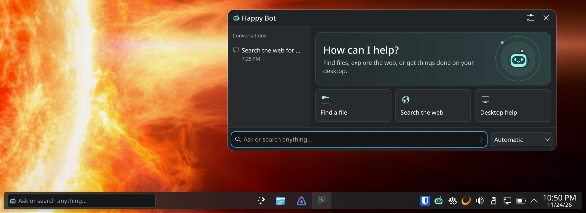

# Happy Bot

**An AI search bar for the KDE Plasma 6 panel. Type what you want and your
computer does it.**



Happy Bot sits in your panel beside the application launcher, or floats
over your windows. Ask it to "put these two windows side by side", "find
the PDF I downloaded last week", "turn on night light" or "what is using
all my disk space?". It finds files through the search you already have,
answers from the web through a search tool you choose, and acts on the
desktop through KDE's own interfaces and tool servers (MCP). It does this
with **whichever AI you pick**: one running on your own computer
(llama.cpp, Ollama, LM Studio, …) or an online service with your own API
key.

It is an add-on you choose to install. Nothing in Plasma depends on it,
and it does nothing until you ask.

## Privacy and Safety

- **No account, no telemetry.** Happy Bot only talks to the AI and search
  services you set up, plus Open-Meteo when you ask about the weather.
- **What it reads from your apps stays on this computer by default.** That
  means the app you are in, its window, selected text, and a screenshot
  taken only when you click "Help with …". Only AIs running on this
  computer see it unless you choose otherwise under Behaviour. With an
  online AI, whatever the tools read for a request (clipboard, file
  contents) is sent to that service.
- **It asks before anything risky.** Deleting, moving to the trash,
  replacing files, installing software and other system changes wait on
  an approval card. You can make it ask more often.
- **It never handles your password.** Anything that needs one opens in a
  terminal window, where you type it yourself.
- **Changes can be undone.** "undo that" reverses the last change, and
  every change is recorded until you log out.
- **Only you can reach it.** The background service listens only on this
  computer, needs a token only your account can read, and refuses web
  pages.
- **History is private and expires.** Conversations are readable only by
  you and are deleted after 30 days without use (you can keep none).

## Quick Start

You need Plasma 6 on Wayland, Python 3.11 or newer and PyGObject
(`python-gobject` or `python3-gi`).

```bash
git clone https://github.com/Dragonswithin/happy-bot-kde.git
cd happy-bot-kde
scripts/install.sh
```

No root is needed: everything goes into your home folder. Happy Bot
appears in the panel beside your launcher. Right-click it and choose
**Configure Happy Bot…** to add an AI (**Find on this computer** or
**Online service…**) and a file and web search, then just type.
`scripts/install.sh --uninstall` removes it again. There are more details
under [Install](#install).

## Feedback Welcome

Happy Bot is young (version 0.1) and made by one person. If you try it, I
would love to hear how it went, especially which AI and distribution you
used.

- Something broke or behaved oddly:
  [open an issue](https://github.com/Dragonswithin/happy-bot-kde/issues/new/choose),
  or choose **Send feedback…** from Happy Bot's right-click menu.
- Ideas, questions and first impressions:
  [Discussions](https://github.com/Dragonswithin/happy-bot-kde/discussions).
- Contributing code: see `CONTRIBUTING.md`. The goal, architecture and
  phase order are in `docs/ROADMAP.md`.

## What Works Today

- The panel icon or widget shortcut opens the full assistant next to the
  panel. Under **Show in panel → Search bar**, the bar is a search like the
  application launcher's (below); click the bar's logo, or press Enter on
  an empty bar, to open the assistant. Vertical panels always show the icon.
- **Happy Bot the app**: "Happy Bot" in the application menu starts the
  floating Happy Bot, a button over other windows that you drag anywhere and
  that fades while not in use. Clicking it opens Happy Bot right there,
  field and all; no panel widget is needed. Launching it again (or a launch
  shortcut set in System Settings > Shortcuts) opens or closes it.
  Right-click the floating button for Happy Bot's settings or to quit. Happy Bot knows
  which application you are in when opened this way or with the hotkey,
  without your saying so and without showing anything; you can still ask
  about anything else.
- The panel widget (search bar or icon) is optional and works alongside the
  app. Its own settings are only what concerns the panel (icon or search
  bar, the bar's width); everything else is set in Happy Bot itself, so the
  panel widget and the floating Happy Bot always match.
- With two or more AIs set up, a drop-down beside the typing field picks the
  AI for the current chat ("Automatic" follows your order); reopening a
  chat brings its pick back.
- The panel's search bar searches as you type, like the application
  launcher: right above the bar it lists installed applications, System
  Settings pages, quick answers (sums, conversions, dates),
  saved chats and files (through a search tool you already have), with no
  AI model involved, in a list that scrolls. Under Appearance → Search you
  can add your browsers' bookmarks and recently visited websites (Firefox,
  Chrome, Chromium, Brave, Vivaldi, Edge, Opera and others), read on this
  computer only. The top result is selected and
  Enter opens it, so "minecraft" and Enter starts your Minecraft launcher.
  The AI is asked only from the "Ask Happy Bot about …" row under the
  results: click it, or press Down to it and Enter (when nothing matches it
  is already selected).
- **Search bar speed-ups**: click into the empty bar to see what you used
  last (applications, files, settings pages, chats, and websites when
  switched on) as buttons; Down and Enter pick one. Type a command such as
  "volume 30", "mute", "dark mode", "timer 10m", "lock", "wifi off" or
  "dnd 30m" and Enter does it at once, no AI involved. "emoji heart" or
  "euro sign" lists characters and Enter copies one. Right-click an
  application to update it, uninstall it (in a terminal, where you
  confirm) or start it at login; right-click a file to send it to your
  phone (KDE Connect). In Happy Bot itself, "Find a file" and "Search the
  web" work the same way: recent items first, then matches as you type;
  "Search the web" lists your bookmarks, visited websites and pages from
  your web search tool, and Enter opens one.
- **Fix selected text**: give the "Fix selected text" shortcut a key
  (System Settings > Shortcuts > Happy Bot Shortcuts), select text in any
  application and press it. Happy Bot shows the text with Fix grammar,
  Shorter, Translate and Explain, or type what to do with it ("make it
  formal", "translate into French"). Replace puts the result in place of
  the selection (Undo in that application brings the old text back);
  Copy copies it. It uses the first AI in your order that your privacy
  setting lets see text from your applications.
- **Talk to it**: switch on the microphone under AI Model → Voice ("Find on
  this computer" finds a local Whisper), then click the microphone in the
  panel bar, the popup or the floating Happy Bot, or press the "Talk to Happy
  Bot" shortcut you set in System Settings. Talk and pause: what you said
  goes to the AI. Only recordings with speech are sent, and each is deleted
  right after.
- **Click instead of typing**: when a request is unclear, the AI can ask one
  short question with answer buttons, and after an answer it can offer up to
  three next steps as buttons ("Open it", "Install it"). A click sends that
  text as your reply; you can always type something else.
- In the popup and the floating Happy Bot, what you type is a request for
  the assistant, which searches files or the web when it needs to. "Find a
  file" on the welcome screen searches as you type there, the same way as
  the panel's search bar.
- The welcome screen's help shortcut names the application you were in
  ("Help with Kate") however you open Happy Bot: the floating button, the
  hotkey or the panel. The AI is told that application, its window title
  and its version, and Plasma's; a chat started with "Help with …" also
  gets the text you selected, the window's buttons and text, the file it
  has open and, for an AI marked as seeing pictures, a screenshot of the
  window. The screenshot is taken only when you click "Help with …" (your
  app comes to the front for a moment), never when Happy Bot opens. Who may see this is yours to choose on the Behaviour page: AIs on
  this computer only (the default), any AI, or none. "Close chat" goes back
  to the welcome screen; the chat stays in your saved ones.
- Tool servers (MCP, stdio) are started and supervised by the daemon. Ones
  you already configured for other AI programs can be imported.
- Desktop context capture: active window (KWin), clipboard (Klipper),
  explicit screenshots (Spectacle).

- Requests typed into the bar are carried out or answered by the AI model
  you configure, streamed into the popup with a line for each step.
- The assistant can read and act: arrange, focus and close windows, start
  applications, open files and links, change volume, media playback, Wi-Fi,
  Bluetooth, displays, colour scheme and KDE settings, set the clipboard,
  create, move and copy files, and run shell commands.
- Anything that deletes (including moving to the trash and replacing a
  file) or makes an OS-level change, installing software included, pauses
  and shows an approval card.
- Long steps show that they are alive: a spinner, how long they have run,
  and the latest line of output. Stop ends a running command at once, and a
  desktop notification says when a request that took over a minute is done
  (under Behaviour you can turn it off or change the time). It shows the
  robot mascot when you chose the mascot under Appearance.
- Installs, builds and anything that needs your password open in a terminal
  window, where you watch the progress and type the password yourself; the
  assistant never handles it. It waits for that window's command to finish
  (the box says it is waiting for you), then reports how it went.
- When installing, it follows your instructions on the Behaviour settings
  page; the suggested ones say to use official, pre-built packages before
  building from source, to ask before any third-party source, and never to
  stop a program it started for you. It checks afterwards that the app shows
  in the launcher, refreshing the launcher (and, if needed, restarting the
  panel right after the request) when it does not.
  Everything else runs at once. The Behaviour settings page (or
  `happy-bot policy changes` / `policy everything`) makes it ask more
  often.
- Conversations are kept: reopening the box returns to the current one, and
  a sidebar lists earlier ones to reopen and continue. They are saved,
  readable only by you, in `~/.local/share/happy-bot/conversations`
  and deleted 30 days after their last use (changed on the History & Folders
  settings page; 0 saves nothing). They can contain whatever the assistant
  read for you.
- Every action that changed something is recorded in
  `$XDG_RUNTIME_DIR/happy-bot/actions.jsonl` until you log out.

- It can operate other applications: read a window's buttons, menus and
  fields through the accessibility interface, press them, fill in text, and
  send keys. The first time it sends keys, Plasma asks you to allow input
  control. Applications that expose no accessibility information cannot be
  operated this way.

## Settings

Right-click the floating Happy Bot (or the panel widget) and choose
**Configure Happy Bot…**. It is Happy Bot's one settings dialog: every
setting has a control there, including whether the panel shows Happy Bot's
icon or a search bar; no file needs editing. The floating Happy Bot and the
panel widget always look and behave the same.

- **AI Model:** your AIs in one list, in the order they are asked: the
  first answers, and if it fails the next one does. Arrows change the order;
  **Settings** under each AI holds its address, key, headers, context
  window, whether it sees pictures, whether it hands long requests to the
  next AI, and for an online one its prices and monthly limit. Add an AI
  with **Find on this computer**, **Online service…** (pick the service,
  open its key page, paste the key, pick a model; Claude, OpenAI, Google
  Gemini, Grok, Qwen, Muse, Mistral, DeepSeek, Kimi, Groq and OpenRouter) or
  **By hand…** for any other OpenAI-compatible service. Each one is tested
  when added, and **Test** next to it checks that Happy Bot works with it:
  answering, one and two tool calls at once, reading a tool's result,
  continuing a chat another AI started, and pictures if it sees them (a few
  small requests; for an online AI a fraction of a cent).
- **Search & Tools:** press **Set up** next to Files or Web and choose
  **Use this** on the recommended choice; Happy Bot adds it and tries a
  search before keeping it. Choices come from what the computer already has
  (KDE's file search, tools set up for other AI programs, a SearXNG you
  run) and a few checked web searches (DuckDuckGo needs no key; Brave and
  Tavily need a free key). **By hand…** picks the server, tool, which
  argument gets the text and how many results yourself; connected tool servers, each with an on/off switch, a
  "look-up only" mark, its start command, environment values such as API
  keys, and which of its tools the assistant may use; a scan for servers
  set up for other AI programs; connecting one by hand.
- **Behaviour:** when to ask for approval; which AI may see the app you are
  in (only AIs on this computer, any AI, or off); **Allow…** next to *Typing into
  other apps*, which asks Plasma's permission once; which kinds of action the
  assistant may take at all (windows, applications, other apps' buttons
  and typing, system settings, files, commands); your own standing
  instructions; steps per request, how long commands may run, when to
  notify; which terminal installs open in.
- **History & Folders:** how long conversations are kept, deleting them
  all, and where Desktop, Documents, Downloads, Pictures, Music and Videos
  are.
- **Appearance:** the robot mascot or the wand, the hotkey, starting
  Happy Bot at login, how faded the floating Happy Bot is and putting it
  back in its corner, the popup's size, and in the panel Happy Bot's icon
  or a search bar, and the bar's width.

API keys and other secrets typed there are stored in the daemon's settings
file (mode 0600) and never shown again.

## More Things It Does

Besides the bar and the settings above:

- **Quick results in KRunner**, with no AI model: a calculator, unit
  conversions (with `qalc`), dates ("3 weeks from friday"), world clocks
  ("time in Tokyo"), applications, System Settings pages and
  earlier conversations. In Happy Bot's own field, optional prefixes say
  what Enter asks: `?` the web, `>` run a command. Up and Down recall
  earlier requests; in the file finder Tab completes, and files have a
  right-click menu and can be dragged.
- **KRunner** (Alt+Space) shows the same results and an "Ask the assistant"
  entry whose answer arrives as a notification.
- **Undo**: "undo that" reverses the last change (file moves, new or
  replaced files, the trash, volume, brightness, themes, window places and
  more); "what did you do today?" is answered from the action log; after
  every answer the popup lists anything that was not done.
- **Reminders, routines and notes**: "remind me at 4…", saved routines that
  run by name, on a schedule, when a folder changes or when a drive is
  plugged in, quick notes and a to-do list in Markdown files. Conversations
  can be pinned in the sidebar to keep them.
- **Desktop and devices**: media and sound devices, the phone through KDE
  Connect, Bluetooth, brightness, night light, Do Not Disturb, power
  profiles, themes, keyboard layouts, key repeat, mice and touchpads,
  printers, VPNs, removable drives, the weather,
  default applications and autostart, virtual desktops, activities and
  saved window layouts.
- **Files and documents**: archives, conversions, picture edits, PDF pages,
  duplicates, the trash, comparing files, reading text in pictures (OCR),
  recent files, bookmarks and reading web pages.
- **For power users**: the system log, user services, processes, Git,
  containers, network checks, software search across every source (marking
  what is already installed) and the update history. With Shelly installed,
  the assistant installs through Shelly in a terminal window.

Commands:

```bash
happy-bot doctor                     # check everything, with fixes
happy-bot eval [--model NAME]        # try a model on everyday requests (changes nothing)
happy-bot ask --dry-run "…"          # say what it would do, change nothing
happy-bot history [ID]               # earlier conversations
happy-bot export FILE / import FILE  # move settings (without secrets) and conversations
happy-bot mcp-serve                  # let another AI program use the tools (enable in settings)
```

Global shortcuts for "Explain selected text" and "Ask about this window" are
under System Settings > Shortcuts > Happy Bot Shortcuts (no keys are set
by default). An Arch package recipe is in `packaging/arch/`.

## Setting Up From The Command Line

The main settings can also be scripted. For a model, any
service with an OpenAI-compatible chat API works, local or hosted:

```bash
happy-bot model probe http://127.0.0.1:8080          # what does it offer?
happy-bot model add NAME --url URL [--model ID]       # local, no key
happy-bot model add NAME --url URL --model ID --key-stdin   # paste the key, Enter
happy-bot model test                                  # answers? can call tools?
happy-bot model check [NAME | --all]                  # does Happy Bot work with it? (see below)
happy-bot model use NAME
happy-bot ask "what is on my clipboard?"
```

`--header NAME=VALUE` adds a request header for services that need one.
`happy-bot folders` shows where the assistant thinks Desktop,
Documents and Downloads are (it follows the system's settings), and
`happy-bot folders Documents /some/path` overrides one. With
a hosted model, whatever the tools read (clipboard, file contents) is sent to
that service.

For search and tools:

```bash
happy-bot tools discover          # servers found in other programs' settings
happy-bot tools import NAME       # add one (--read-only if it changes nothing)
happy-bot tools list              # its tools, and suggested roles
happy-bot role set file_search SERVER TOOL
happy-bot role set web_search SERVER TOOL
happy-bot search some words
```

Settings are stored in `~/.config/happy-bot/config.json` (mode 0600).
The schema is documented at the top of `src/happy_bot/settings.py`.
Change them through the settings dialog or the commands above rather than by
editing the file; the daemon validates and applies changes immediately.

Useful environment overrides:

- `HAPPY_BOT_DAEMON_HOST`
- `HAPPY_BOT_DAEMON_PORT`
- `HAPPY_BOT_DAEMON_URL`
- `HAPPY_BOT_ROOT_BROKER`
- `HAPPY_BOT_ADMIN_GROUP`

## Install

From a checkout of this repository, as your normal user:

```bash
scripts/install.sh
```

That installs the daemon, the command-line client and the Happy Bot app,
starts the daemon as a systemd user service tied to your Plasma session,
installs the panel widget and, the first time, adds it to the panel that
holds your application launcher (`--no-panel` skips that). Then right-click
Happy Bot and choose **Configure Happy Bot…** to set it up:

1. **AI Model.** **Find on this computer** lists model services that are
   running locally; **Online service…** adds a hosted one with your API
   key; **By hand…** takes any OpenAI-compatible address. Each one is
   tested when you add it.
2. **Search & Tools.** **Set up** next to Files or Web offers what the
   computer already has (KDE's file search, tool servers set up for other
   AI programs, a SearXNG you run) and a few web searches, and tries a
   search before keeping it.
3. **Behaviour** and **History & Folders.** Sensible defaults; change them
   if you want.

Nothing needs to be edited by hand. Running the installer again upgrades in
place; after an upgrade, log out and in (or restart plasmashell) so the panel
loads the new widget code.

What goes where:

- `src/happy_bot/` to `~/.local/lib/happy-bot/happy_bot/`
- `launchers/happy-bot-daemon`, `launchers/happy-bot` and
  `launchers/happy-bot-app` to `~/.local/bin/`
- the "Happy Bot" menu entry, the KRunner plugin and the global-shortcut
  entry to `~/.local/share/`
- `systemd/user/happy-bot-daemon.service` to
  `~/.config/systemd/user/`
- the Plasma widget to your Plasma package store (`kpackagetool6`)
- your settings, created on first use, in `~/.config/happy-bot/`

To remove it:

```bash
scripts/install.sh --uninstall           # keeps your settings
scripts/install.sh --uninstall --purge   # removes them too
```

Whether the panel shows Happy Bot's icon (the default) or a search bar,
the bar's width and Happy Bot's hotkey are on the **Appearance** page of
Happy Bot's settings.

Translations of the widget live in `po/<language>.po`. `scripts/translations.sh
template` writes the template to start one from, `merge` brings every
language up to date after strings change, and the installer and the Arch
package compile them into the widget. There are no translations yet.

To test the widget in a window instead of a panel:

```bash
plasmawindowed io.github.dragonswithin.happybot
```

Widget load errors are not printed to the terminal; read them with
`journalctl --user -e | grep -E 'plasmashell|plasmawindowed'`, or set
`QT_FORCE_STDERR_LOGGING=1`.

To look at one view after a change, without reinstalling or restarting the
panel, draw it to a picture (views that need the running widget cannot be
drawn this way):

```bash
scripts/preview_qml.sh WeatherCard.qml /tmp/weather.png 'weather: ({...})'
```

To try setup or requests without touching your own settings, start a second
daemon with empty settings and point the CLI at it:

```bash
scripts/throwaway_daemon.sh start
eval "$(scripts/throwaway_daemon.sh env)"
python3 -m happy_bot.cli doctor
scripts/throwaway_daemon.sh stop
```

## Access Control

The daemon listens on loopback only and can act for the user, so every
request must carry the bearer token it writes at each start to
`$XDG_RUNTIME_DIR/happy-bot/token` (mode 0600). Requests with an
`Origin` header (any browser page) or a foreign `Host` header are refused.
The CLI and the widget read the token themselves.

## Checks

```bash
python3 -m unittest discover -s tests
python3 -m py_compile src/happy_bot/*.py
python3 -m py_compile src/happy_bot/*/*.py
bash -n scripts/install.sh
QT_FORCE_STDERR_LOGGING=1 /usr/lib/qt6/bin/qmllint -I /usr/lib/qt6/qml plasmoid/*/contents/ui/*.qml
systemd-analyze --user verify systemd/user/happy-bot-daemon.service
systemctl --user status happy-bot-daemon.service
happy-bot status --pretty
happy-bot context --kind window --pretty
/usr/lib/qt6/bin/qmltestrunner -input tests/tst_StreamingAnswer.qml   # the Qt 6 runner
/usr/lib/qt6/bin/qmltestrunner -input tests/tst_BehaviourPage.qml
/usr/lib/qt6/bin/qmltestrunner -input tests/tst_FieldSide.qml
/usr/lib/qt6/bin/qmltestrunner -input tests/tst_ResultGroups.qml
happy-bot model check --all          # does Happy Bot work with each configured AI? (small requests)
```

`tests/test_recorded_replies.py` replays what real AI services streamed
back (`tests/fixtures/model_replies/<service>/`), so a change that misreads
one service fails the tests without any network. To record a service again,
or add one, run `scripts/record_model_replies.py LABEL=MODEL` (it only shows
the plan; add `--record` to send four small requests and save the replies,
which it refuses if they contain a key or personal details).

## Requirements

Plasma 6 on Wayland, Python 3.11 or newer, and PyGObject (`python-gobject`
or `python3-gi`) with `at-spi2-core`, which the window and application
control tools use to talk to KWin, the accessibility bus and the desktop
portal. Everything else is the Python standard library.

## Notes

This is a desktop-session assistant: the daemon runs as a systemd user unit
tied to the Plasma session and stops when you log out. Model services and
tool servers that should outlive the session are managed by their own owners;
the daemon only connects to them.
